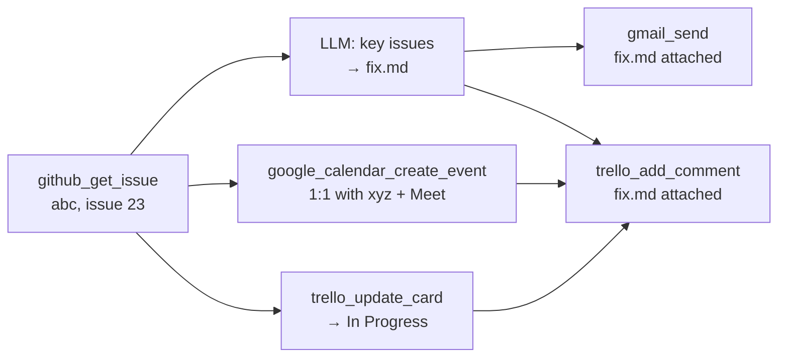

Fibonacci reads your repositories and your trackers the way you do, then does the follow-up you'd otherwise do by hand. Describe the job in one sentence:

> Get issue 23 from GitHub in the abc repo, find the key issues and make a fix.md, send it to xyz, set a one-on-one with xyz, and update the work in Trello.

Fibonacci turns that into a workflow and runs it:



- **The issue** is read with its whole discussion. `abc` is found among the repositories your token can see, so you don't have to type `owner/abc`.
- **fix.md** is written by Claude from the issue, and travels as a real file: attached to the email and to the Trello card.
- **xyz** gets the email and a calendar invitation with a Google Meet link, at 10:00 on the next business day in your calendar's time zone, because you didn't name a time.
- **The card** for issue 23 moves to *In Progress* and gets a comment saying what happened.
- If you didn't give xyz's email, Fibonacci asks for it as an input before the run. It never guesses an address.

<Note>
  The GitHub tools **read**. The only GitHub writes are reviewing and commenting on a pull request. Changes go to Jira and Trello, and messages to people, where your org's [governance rules](/guides/governance) can hold or block them.
</Note>

---

## Connect your accounts

Each person adds their own credentials to their **Secrets Locker** (Dashboard → Secrets Locker; **Organization → Integrations → Developer tools** walks through each one). Runs act as that person, with their permissions.

<Tabs>
  <Tab title="GitHub">
    | Secret | What it is |
    |---|---|
    | `GITHUB_TOKEN` | A [fine-grained personal access token](https://github.com/settings/personal-access-tokens/new) |

    For reading, give the token **read** access to *Metadata, Contents, Issues, Pull requests, Commit statuses* and *Checks* on the repositories you want. Add **Pull requests: write** only if workflows should post reviews or PR comments. If your organization uses SAML single sign-on, authorize the token for it (Configure SSO → Authorize).
  </Tab>
  <Tab title="Jira">
    | Secret | What it is |
    |---|---|
    | `JIRA_BASE_URL` | Your Jira Cloud site, e.g. `https://acme.atlassian.net` |
    | `JIRA_EMAIL` | The Atlassian account the token belongs to |
    | `JIRA_API_TOKEN` | [id.atlassian.com → Security → API tokens](https://id.atlassian.com/manage-profile/security/api-tokens) |

    Work happens as that account: it needs permission to browse, edit, transition and comment in the projects you use.
  </Tab>
  <Tab title="Trello">
    | Secret | What it is |
    |---|---|
    | `TRELLO_API_KEY` | [trello.com/power-ups/admin](https://trello.com/power-ups/admin) → your Power-Up → API key |
    | `TRELLO_TOKEN` | The *Token* link next to the key (read and write) |

    The account behind the token must be a member of the boards you use. **Organization → Integrations** builds the token link for you from the key.
  </Tab>
  <Tab title="Email and calendar">
    Sign in with Google once (Settings → Integrations). `gmail_send` and `google_calendar_create_event` then send and invite as you. No secret to paste.
  </Tab>
</Tabs>

---

## GitHub: read, check, maintain, document

Every GitHub tool takes the repository the way you'd write it: `owner/name`, a `github.com` link, or just the name. Issues and pull requests can be `23`, `#23`, `owner/name#23` or their link. Something that isn't a number (`23a`) is refused before anything is called, with an explanation.

| Tool | What it returns | Good for |
|---|---|---|
| `github_get_issue` | Title, body, labels, assignees, comments, and **`text`**: the whole thread as one document for an LLM step | Turning an issue into a plan, a reply, a ticket |
| `github_list_issues` | Open (or closed) issues, by labels, assignee, or a text `query` | Triage, "what's open about login?" |
| `github_get_file` | A file's text at a branch, tag or commit (or a folder's entries). Takes `…/blob/…` links | Reading the code an issue is about, a README, a config |
| `github_search_code` | Paths and matching lines for a word, symbol or error message | "Where is `refresh_token` handled?" |
| `github_list_commits` | Commits on a branch, `since`/`until` a date (`{{yesterday}}` works), by path or author | Changelogs, standups, release notes |
| `github_list_pull_requests` | PRs with author, draft flag, requested reviewers and `days_since_update` | Stale-PR nudges, review load |
| `github_get_checks` | CI `state` (success / failure / pending / none), what failed, a one-line `summary`, for a PR, branch or commit | "Is main green?", failed-build alerts |
| `github_get_pr` | A PR's metadata and per-file patches | Code review |
| `github_post_pr_review` · `github_post_pr_comment` | Post a review (comment / approve / request changes) or a comment | Automated review |

<Tip>
  Hand an issue to an LLM step with `{{read_issue.text}}`. Named fields like `.text` reach the step in full, while a whole node output (`{{read_issue}}`) is cut to about 6,000 characters.
</Tip>

---

## Jira and Trello: keep the timeline current

| | Read | Change | Comment (notifies people) |
|---|---|---|---|
| **Jira** | `jira_get_issue` (key `PROJ-123` or link, with a `text` field), `jira_search_issues` (JQL, or project / text / status / assignee) | `jira_create_issue`, `jira_update_issue`: status (through the matching workflow transition), assignee (`me`, email or name), summary, description, labels, priority, due date | `jira_add_comment`, with an optional attached file |
| **Trello** | `trello_get_board` (every list and its cards), `trello_search_cards` | `trello_create_card`, `trello_update_card`: move to a list by name, rename, description, due / done, members, labels, archive | `trello_add_comment`, with an optional attached file |

- **Names, not IDs.** Boards by name or link, lists by name (`"In Progress"`), cards by link or, with a board, by their name (`"#23"` finds *"#23 Login times out"*). If a name matches two cards or no list, the step stops and says which ones exist.
- **Markdown in, Markdown out.** Jira's rich-text format is converted both ways, so headings, lists and code blocks survive.
- **Statuses move the right way.** `status: "Done"` uses the transition that leads to *Done* from where the issue is; if there isn't one, the error lists where it can go.

---

## Files, people and meetings

| You say | What happens |
|---|---|
| "make a fix.md" | An LLM step writes Markdown. Pass it as `attachment_content` with `attachment_name: "fix.md"` to `gmail_send`, `jira_add_comment` or `trello_add_comment`. |
| "send it to xyz" | `gmail_send` to xyz's email, which becomes a workflow input if you didn't give it. `to: "me"` sends to whoever ran the workflow. |
| "set a 1:1 with xyz" | `google_calendar_create_event` with `attendees: ["{{input.xyz_email}}"]` and `add_meet_link: true`. With no `start_time` it books the next business day at 10:00 in your calendar's zone for `duration_minutes` (30). |
| "tell me on Slack" | `slack_send_message` with channel `@me`, a direct message. |

---

## The example, as a workflow

This is the shape the generator produces for the request at the top (you can also write it yourself, in the API or the SDK):

```json
{
  "name": "Issue to fix plan",
  "nodes": [
    {"id": "read_issue", "type": "tool", "tool_name": "github_get_issue",
     "tool_params": {"repo": "abc", "issue": "23"}, "dependencies": []},

    {"id": "write_fix", "type": "llm", "dependencies": ["read_issue"],
     "instruction": "Find the key problems in this issue and write fix.md: the cause, the fix, the files to change and how to test it.\n\n{{read_issue.text}}",
     "config": {"max_tokens": 2000}},

    {"id": "email_fix", "type": "tool", "tool_name": "gmail_send", "dependencies": ["write_fix"],
     "tool_params": {"to": "{{input.xyz_email}}", "subject": "Fix plan: {{read_issue.title}}",
                     "body": "Plan for {{read_issue.url}} attached.",
                     "attachment_name": "fix.md", "attachment_content": "{{write_fix}}"},
     "config": {"continue_on_error": true}},

    {"id": "one_on_one", "type": "tool", "tool_name": "google_calendar_create_event", "dependencies": ["read_issue"],
     "tool_params": {"summary": "1:1: {{read_issue.title}}", "attendees": ["{{input.xyz_email}}"],
                     "description": "{{read_issue.url}}", "add_meet_link": true},
     "config": {"continue_on_error": true}},

    {"id": "move_card", "type": "tool", "tool_name": "trello_update_card", "dependencies": ["read_issue"],
     "tool_params": {"card": "#{{read_issue.number}}", "board": "{{input.trello_board}}", "list": "In Progress"},
     "config": {"continue_on_error": true}},

    {"id": "note_card", "type": "tool", "tool_name": "trello_add_comment",
     "dependencies": ["write_fix", "one_on_one", "move_card"],
     "tool_params": {"card": "#{{read_issue.number}}", "board": "{{input.trello_board}}",
                     "text": "Fix plan sent to {{input.xyz_email}}; 1:1 at {{one_on_one.start_time}} ({{one_on_one.meet_link}}).",
                     "attachment_name": "fix.md", "attachment_content": "{{write_fix}}"},
     "config": {"continue_on_error": true}}
  ]
}
```

Run it with `{"xyz_email": "xyz@acme.com", "trello_board": "Sprint 12"}`. The issue read, the 1:1 and the card move happen in parallel; the email and the Trello note wait for fix.md.

<Note>
  Templates work inside lists and objects too: `["{{input.xyz_email}}"]` resolves to the address.
</Note>

---

## More recipes

<AccordionGroup>
  <Accordion title="Triage: open bugs into one Jira ticket" icon="bug">
    > List open GitHub issues in acme/api labelled bug, rank them by impact, and open a Jira task in OPS with the ranking, assigned to me.

    `github_list_issues` (labels `bug`) → LLM ranks them → `jira_create_issue` with the ranking as the description and `assignee: "me"`. Save the workflow and run it whenever you triage, or from your own scheduler through the [execute API](/api-reference/overview#run-a-workflow).
  </Accordion>
  <Accordion title="Red main branch → Slack" icon="triangle-exclamation">
    > Check CI on main in acme/web; if it's failing, DM me which checks failed and the last three commits.

    `github_get_checks` (no ref = default branch) → `github_list_commits` (`limit: 3`) → `slack_send_message` to `@me` with `{{checks.summary}}`, with a condition on `{{checks.state}}` equals `failure` so nothing is sent when it's green.
  </Accordion>
  <Accordion title="Standup from yesterday's commits" icon="list-check">
    > Summarize what I committed in acme/api since yesterday, post it to #standup, and mark the card "Token refresh" on Sprint 12 done.

    `github_list_commits` with `since: "{{yesterday}}"` and `author` → LLM summary → `slack_send_message` and `trello_update_card` (`list: "Done"`).
  </Accordion>
  <Accordion title="Stale pull requests" icon="clock">
    > List PRs in acme/web with no update for a week, with who they're waiting on, and email me the list.

    `github_list_pull_requests` gives `days_since_update` and `requested_reviewers` → LLM writes the digest → `gmail_send` to `me`.
  </Accordion>
  <Accordion title="Release notes from the code" icon="file-lines">
    > Write release notes for acme/api from commits since 2026-10-01 and the CHANGELOG, and attach them to the Jira release ticket OPS-140.

    `github_list_commits` + `github_get_file` (`CHANGELOG.md`) → LLM → `jira_add_comment` with `attachment_name: "release-notes.md"`.
  </Accordion>
</AccordionGroup>

<Note>
  A workflow has a fixed set of steps: it can summarize a list into one ticket, message or document, but not create one ticket per item. For per-item work, run a workflow once per item through the API.
</Note>

---

## Governance for developer data

- **Issue text is untrusted.** Anyone who can open an issue writes it, so `github_get_issue` and `github_list_issues` label their output `internal` *and* `untrusted`. With the rule template **"Approve sends that mix web content with internal data"** active, an email or comment built from an issue waits for a human. That stops a prompt injection hidden in an issue from mailing out your code.
- **Side effects are honest.** Reads are `read`; creating or moving tickets and cards is `write`; comments, emails and invitations are `egress` (they reach people). A `read_only` role can run the read tools and nothing else.
- **Every call is on the receipt.** `GET /runs/{id}/authorization` shows each tool call, its labels and the rule that decided it.

## When something fails

Errors say what to change, and a failure that retrying can't fix (a bad token, a missing permission, an unknown board) fails the step once instead of three times:

| You see | Do this |
|---|---|
| `GitHub rejected GITHUB_TOKEN (expired or revoked)` | Put a new token in the Secrets Locker |
| `None of the repositories GITHUB_TOKEN can see is named "abc"` | Use `owner/abc`, or give the token access to it |
| `GITHUB_TOKEN isn't authorized for this organization's single sign-on` | Authorize the token for SSO on GitHub |
| `OPS-7 can't move to "Blocked" … It can move to: Done, In Progress` | Use one of the listed statuses |
| `No card on "Sprint 12" is named like "#23"` | Create it with `trello_create_card`, or pass the card's link |
| `More than one repository / card matches …` | Use `owner/name`, or the card's link |
